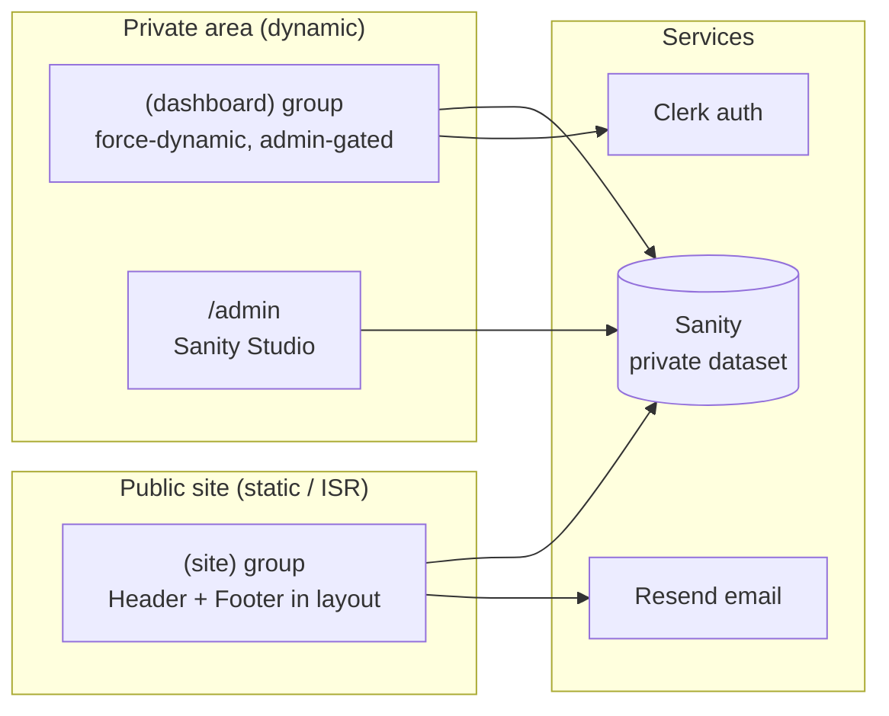
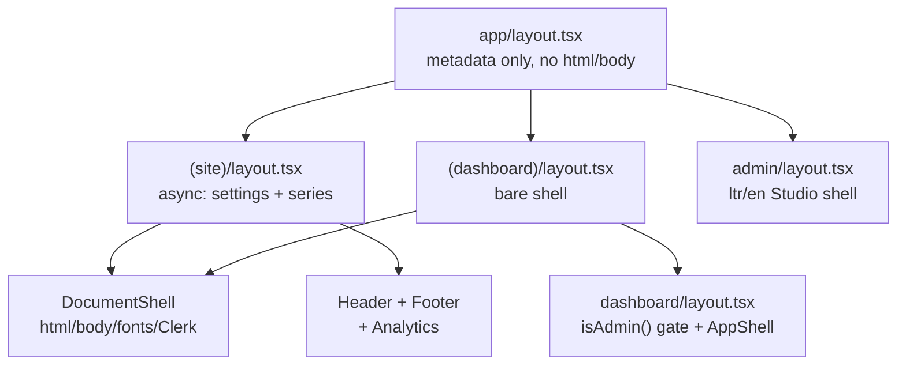
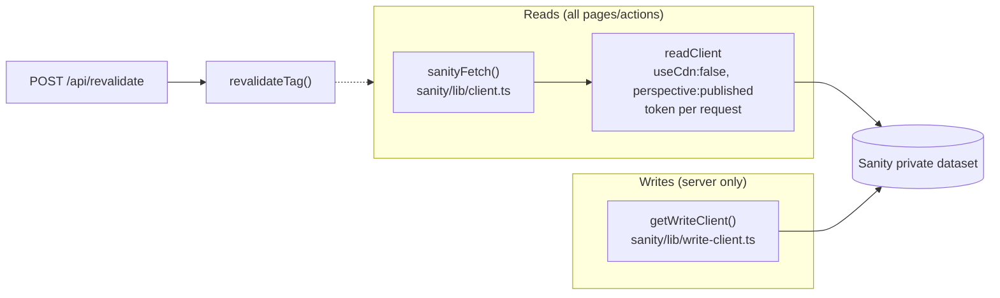
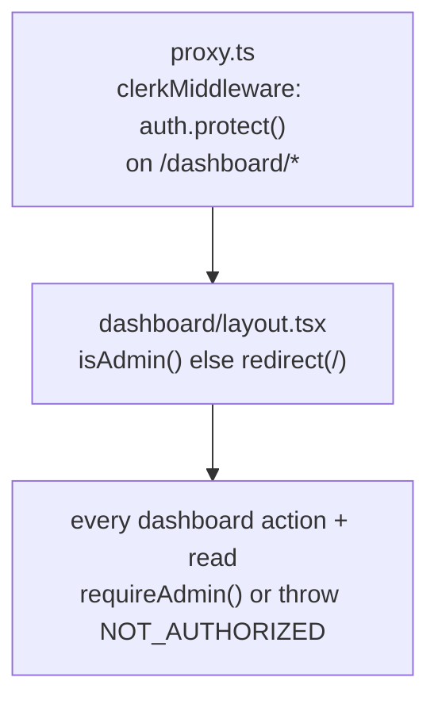
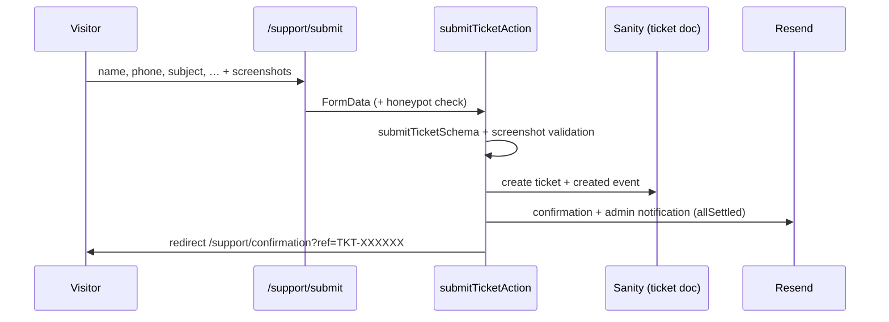

# Maqrat Blog - مدونة مقرات

An Arabic-first (RTL) real-estate blog with a phone-identity
support-ticket system, a Clerk-gated admin dashboard with data visualization,
transactional email, and an embedded Sanity Studio. Posts are articles about
real estate - never per-property listings. Built with Next.js 16
(App Router), Tailwind CSS v4, HeroUI v3, and Sanity as the content backend.

> **For AI agents and new developers:** this document is the canonical map of
> the project. After reading it you should be able to locate any feature,
> predict where a change belongs, and run the project without reading every
> file. Concrete file paths are given for everything; when a path and this
> document disagree, the path wins and this document should be updated.

- [1. Project snapshot](#1-project-snapshot)
- [2. Tech stack](#2-tech-stack)
- [3. Getting started](#3-getting-started)
- [4. Architecture](#4-architecture)
- [5. Route map](#5-route-map)
- [6. Support ticket system](#6-support-ticket-system)
- [7. Admin dashboard](#7-admin-dashboard)
- [8. Sanity Studio guide](#8-sanity-studio-guide)
- [9. Authentication and security](#9-authentication-and-security)
- [10. Theming and conventions](#10-theming-and-conventions)
- [11. Email](#11-email)
- [12. Environment reference](#12-environment-reference)
- [13. Troubleshooting](#13-troubleshooting)

---

## 1. Project snapshot

| Aspect | Fact |
|---|---|
| Product | Arabic RTL real-estate articles blog + support tickets |
| Public site | `/`, `/blog/*`, `/author/*`, `/support/*`, `/sign-in` |
| Admin dashboard | `/dashboard/*` (Clerk, `role === "admin"` required) |
| CMS | Sanity Studio at `/admin` (private dataset, token-authenticated reads) |
| Languages | UI is Arabic (RTL, `ar-EG` numerals/plurals); Studio schema is English |
| Package manager | pnpm (a `pnpm-lock.yaml` is committed; there is no `package-lock.json`) |
| Rendering | Mostly static/ISR public pages; `force-dynamic` dashboard; on-demand revalidation via Sanity webhook |

### 30-second mental model



- **Content** (posts, authors, series, settings) lives in Sanity and is rendered
  statically with tag-based revalidation.
- **Tickets** are created by anonymous visitors (phone number is the identity),
  answered by admins in the dashboard, and tracked publicly by reference number.
- **Settings** (hero copy, footer brand, GA/GTM ids) live in a Sanity singleton
  and are read by layouts, so editors change the site without deploys.

---

## 2. Tech stack

Exact versions are pinned in `package.json`; the table explains *why* each
dependency exists.

| Package | Version | Role |
|---|---|---|
| `next` | 16.3.4 | App Router, RSC, server actions, ISR |
| `react` / `react-dom` | 19.2.8 | UI runtime |
| `tailwindcss` + `@tailwindcss/postcss` | v4 (CSS-first, no config file) | Styling |
| `@heroui/react` / `@heroui/styles` | 3.2.4 | Component primitives (buttons, cards, selects, toasts, pagination) |
| `radix-ui` | 1.6.7 | Headless primitives under `components/ui` |
| `sanity` | 5.31.2 | Studio + schema toolchain |
| `next-sanity` | 13.3.4 | `createClient`, `groq` tag, webhook signature helper |
| `@sanity/client`, `@sanity/image-url`, `@sanity/vision` | 8.x / 2.x / 5.x | Writes, image URLs, Vision tool |
| `@clerk/nextjs`, `@clerk/localizations` | 7.9.0 / 4.16.0 | Auth (Arabic `arSA` localization), admin gating |
| `resend`, `react-email` | 6.x | Transactional email + Broadcast API + JSX templates |
| `zod` | 4.5.4 | Form/action validation |
| `recharts` | 3.8.0 | Dashboard charts (only charting library) |
| `@portabletext/react` | 8.0.1 | Post body rendering |
| `yet-another-react-lightbox` | 3.32.2 | Ticket attachment viewer (+ Zoom/Thumbnails/Counter/Captions) |
| `react-icons` | 5.7.0 | Icons - **Hi2 solid + Fa6 only** (see conventions) |
| `nanoid` | 6.0.1 | `TKT-XXXXXX` reference alphabet |
| `@internationalized/date` | 3.12.4 | HeroUI date picker parsing |
| `@next/third-parties` | 16.3.4 | GA/GTM tags from settings |
| Tooling | - | TypeScript 5, Biome 2.4.2 (lint+format), Prettier + tailwind plugin, `shadcn` 4.x (component generator) |

Scripts (`package.json`):

| Script | Command | Notes |
|---|---|---|
| `dev` | `next dev` | Turbopack; runs `predev` first |
| `build` / `start` | `next build` / `next start` | `prebuild` regenerates types first |
| `lint` / `format` | `biome check` / `biome format --write` | Single source of truth for style |
| `typegen` | `sanity schema extract && sanity typegen generate` | Regenerates `schema.json` + `sanity.types.ts`; auto-runs before dev/build |
| `email:dev` | `email dev --dir emails --port 3001` | Live preview + send test for the `emails/` templates |

---

## 3. Getting started

### Prerequisites

- Node.js 20+, pnpm 9+
- A Sanity project (private dataset) with a read+write API token
- A Clerk application (publishable + secret key)
- A Resend API key (transactional mail; ticket sends are best-effort,
  newsletter subscribe fails fast with an error when unconfigured)

### Setup

```bash
pnpm install
cp .env.example .env.local   # then fill in the 13 variables (see §12)
pnpm dev                     # http://localhost:3000
```

`pnpm dev`/`pnpm build` automatically run `pnpm typegen`, which extracts
`schema.json` and regenerates the fully-typed `sanity.types.ts` (24 query
result types). **Never hand-edit `sanity.types.ts` or `schema.json`.**

### First-run checklist

1. Open `http://localhost:3000/admin`, create content (at least one post with
   `publishedAt <= now()`, otherwise post queries return nothing).
2. Open Settings in the Studio desk and **Publish** the `siteSettings`
   singleton (hero/footer/analytics render nothing until it exists).
3. In Clerk, set the admin user's `publicMetadata.role` to `"admin"`.
4. New-post broadcasts need no webhook: the Studio **Publish & notify**
   action calls the app same-origin (works on localhost). For ISR
   refresh on deployment, point the single Sanity webhook
   (secret = `SANITY_REVALIDATE_SECRET`) at
   `POST /api/revalidate`; without it, published content stays stale
   until the next deploy.
5. In the Resend dashboard (Audience): create the `newsletter` segment,
   then set `RESEND_SEGMENT_ID`. Without it, contact sync warns and
   skips, and broadcasts throw (`[broadcast-send]`, flags stay unset).
   New signups and confirmations sync automatically from then on.

### Quality gates (run before every commit)

```bash
pnpm exec tsc --noEmit
pnpm exec biome check app components lib sanity emails hooks
pnpm build
```

---

## 4. Architecture

### 4.1 Route groups and document shell

Route groups are URL-transparent: `(site)` and `(dashboard)` do not appear in
URLs. There are three document roots:

| Group | Layout | Renders |
|---|---|---|
| `(site)` | `app/(site)/layout.tsx` (async) | `DocumentShell` + `Analytics` + `Header` + page + `Footer` |
| `(dashboard)` | `app/(dashboard)/layout.tsx` (static shell) → `app/(dashboard)/dashboard/layout.tsx` (admin gate + `AppShell`) | `DocumentShell` + sidebar app shell, **no site header/footer** |
| `admin` | `app/admin/layout.tsx` | Own `<html dir="ltr" lang="en">`, Studio only |

`components/document-shell.tsx` is the single owner of `<html dir="rtl"
lang="ar">`, the Thmanyah font variable (`public/fonts/*.woff2`), the
`site-shell` body classes, `ClerkProvider` (`arSA` + `lib/clerk-appearance.ts`)
and `AppProviders`. Global CSS (`app/globals.css`) is imported once per group
layout - Next.js only allows global CSS imports in layouts.

> Rule: pages never render `<Header/>`/`<Footer/>` themselves. A repo-wide
> sweep must show those components referenced only in `(site)/layout.tsx`
> (plus the `navLinks` data import in `mobile-nav.tsx`).



### 4.2 Data layer: reads vs writes



- `sanity/lib/client.ts` (`server-only`): every read carries `SANITY_API_TOKEN`
  because the dataset is private. `next: { tags }` enables webhook-driven
  invalidation.
- `sanity/lib/write-client.ts` (`server-only`, lazy token): used by ticket
  creation, admin ticket actions, and the like API.
- Images: `sanity/lib/image.ts` (`urlFor` builder, `cdn.sanity.io` is the only
  remote image pattern in `next.config.ts`).
- Hand-written domain types live next to queries in `sanity/lib/queries.ts`
  (`PostCard`, `PostDetail`, `SeriesRef`, …); generated GROQ result types live
  in `sanity.types.ts`. `lib/blog.ts` / `lib/dashboard.ts` / `lib/tickets.ts`
  map raw rows into domain types with null-guards (`flatMap` filters, never
  trusting optional fields).

### 4.3 Caching and revalidation

- Public pages are static/ISR. Reads subscribe to cache tags
  (`BLOG_CACHE_TAG = "blog"`, per-type tags, `"siteSettings"`).
- The single Sanity webhook (`POST /api/revalidate`) verifies
  `SANITY_REVALIDATE_SECRET` via `next-sanity/webhook` (500 on missing
  secret, 401 on bad signature), ignores `_type === "ticket"` (tickets
  must never drive blog cache), and revalidates `blog` + the published
  `_type` by tag. No other webhook exists by design.
- The dashboard is `force-dynamic` on every route (`layout.tsx`, `page.tsx`,
  `tickets/page.tsx`, `tickets/[id]/page.tsx`) - admin data is always fresh;
  the like API and ticket actions additionally call `revalidatePath` where a
  static page could be affected.

### 4.4 Admin enforcement (3 layers)



1. `proxy.ts` - optimistic boundary check (sign-in only).
2. `app/(dashboard)/dashboard/layout.tsx` - `isAdmin()` role gate.
3. Every server action **and dashboard data read** (`tickets/[id]/actions.ts`, like-guard reads) calls
   `requireAdmin()` from `lib/admin.ts`, which resolves `role` from session
   claims (fast path) with a Clerk Backend API fallback, cached per request.
   Never rely on layer 1 alone - it is documented as optimistic in the file.

---

## 5. Route map

Conventions below: **S** = static/ISR, **D** = dynamic (`searchParams`,
`force-dynamic`, or `auth()`).

### Public site `(site)`

| URL | File | Mode | Data | Renders |
|---|---|---|---|---|
| `/` (+ `?q=&category=&tag=&page=`) | `(site)/page.tsx` | D (`searchParams`) | `getPosts(pageSize 9)`, conditional `getPinnedPost`/`getFeaturedPosts`/`getSeriesShowcase`, always `getCategories`/`getTags`, conditional `getSiteSettings` | `HeroSection` + `LogosSection` (first page, unfiltered), `FeaturedBento`, `SeriesCard` showcase, `BlogFilters` + `PostCard` grid + `ArPagination`, `SupportCta` |
| `/blog/:slug` | `(site)/blog/[slug]/page.tsx` | S | `getPostBySlug` (also in `generateMetadata`), `getRelatedPosts`, `headingsFromBody`, reading-time helpers, JSON-LD via `lib/seo` | Breadcrumbs, cover `next/image`, `LikeButton`, `PortableContent` + `Toc`, `PostVideo`, series prev/next, author card, related `PostCard`s, `SupportCta` |
| `/blog/:slug/opengraph-image` | `(site)/blog/[slug]/opengraph-image.tsx` | D per slug | `getPostBySlug`, reads `public/fonts/Cairo.ttf` | 1200×630 `ImageResponse` (RTL title + site URL) |
| `/blog/category/:slug` | `(site)/blog/category/[slug]/page.tsx` | S | `getCategoryBySlug`, `getPosts({category, pageSize:100})` | `ArchiveLayout` (kicker تصنيف) |
| `/blog/tag/:slug` | `(site)/blog/tag/[slug]/page.tsx` | S | `getTagBySlug`, `getPosts({tag, pageSize:100})` | `ArchiveLayout` (kicker وسم) |
| `/blog/series/:slug` | `(site)/blog/series/[slug]/page.tsx` | S | `getSeriesBySlug` (posts included, array order) | `ArchiveLayout` (kicker سلسلة مقالات) |
| `/author/:slug` | `(site)/author/[slug]/page.tsx` | S | `getAuthorBySlug` (+ `personJsonLd`) | `ArchiveLayout` with author avatar/links `heroSide` |
| `/support` | `(site)/support/page.tsx` | S | none | Landing band + submit/track cards |
| `/support/submit` | `(site)/support/submit/page.tsx` | D (`?fresh=`) | none (client form) | `SubmitForm` → `submitTicketAction` |
| `/support/track` | `(site)/support/track/page.tsx` | D (`?ref=`) | none (client form) | `TrackForm` → `trackTicketAction` |
| `/support/confirmation` | `(site)/support/confirmation/page.tsx` | D (`?ref=`) | none | Ref display + `CopyButton` + track/submit links |
| `/newsletter/confirm` | `(site)/newsletter/confirm/page.tsx` | D (`?token=`) | none (client form) | `ConfirmForm` → `confirmSubscription` (explicit click only - never auto-confirms, so link scanners can't subscribe anyone) |
| `/newsletter/unsubscribe` | `(site)/newsletter/unsubscribe/page.tsx` | D (`?email=`) | none (client form) | `UnsubscribeForm` → `unsubscribeNewsletterAction` |
| `/sign-in/*` | `(site)/sign-in/[[...sign-in]]/page.tsx` | S | none | Clerk `<SignIn routing="path">` |
| `/sitemap.xml` | `app/sitemap.ts` | build/request | posts(1000), categories, tags, series | Posts, taxonomies, support pages |
| `/robots.txt` | `app/robots.ts` | S | `siteUrl()` | Allows `/`, disallows `/dashboard/ /admin/ /api/` |
| `/rss.xml` | `app/rss.xml/route.ts` | D | `getPosts(pageSize 50)` | Hand-built RSS 2.0 |

### Dashboard `(dashboard)` - all `force-dynamic`, admin-gated

| URL | File | Data | Renders |
|---|---|---|---|
| `/dashboard` | `(dashboard)/dashboard/page.tsx` | `getTicketStats()`, `getAdminTickets({pageSize:10})`, `getRecentActivity()`; aggregation in-component (tiles, per-day series, deltas, priority/category slices) | `Dashboard` grid: `DashboardStats`, 4 charts, `RecentTickets`, `TicketAlerts`, `DashboardActivity` |
| `/dashboard/tickets?…` | `(dashboard)/dashboard/tickets/page.tsx` | `getAdminTickets(filters, default pageSize 20)` | `DashboardFilters`, table (`TicketTableRow`, `TicketStatusBadge`), `ArPagination` |
| `/dashboard/tickets/:id` | `(dashboard)/dashboard/tickets/[id]/page.tsx` | `getTicketDetail` (+ `notFound()`), `getAdminUsers()` | Breadcrumb, detail grid, `AttachmentGallery`, status/assign forms, timeline, reply/note forms |
| Studio | `app/admin/[[...tool]]/page.tsx` | none | `NextStudio` (`force-static`) |

### API routes

| Route | File | Behavior |
|---|---|---|
| `POST /api/revalidate` | `app/api/revalidate/route.ts` | 500 on missing secret → 401 on bad signature, 400 on missing `_id`/`_type` → ignores `ticket` → `revalidateTag(blog)` + `revalidateTag(_type)`; the single Sanity webhook target |
| `POST /api/broadcast/send` | `app/api/broadcast/send/route.ts` | Shared-token check → 401/400 → `maybeBroadcastNewPost()` → `{ ok, result }`; called by the Studio publish action (same origin, no tunnel needed); the sole email trigger |
| `POST /api/posts/:slug/like` | `app/api/posts/[slug]/like/route.ts` | Zod `{delta: 1\|-1}` → resolve `_id` + current `likes` via `ID_LIKES_BY_SLUG_QUERY` → clamp `max(0, likes+delta)` → `set({likes})` → `{likes}` |

---

## 6. Support ticket system



- **Phone is the identity.** `lib/ticket-schemas.ts` (`normalizePhone`,
  `phoneSchema`) + `lib/tickets.ts` (`getPublicTicket` matches
  `reference` AND `email|phone`). Public error messages never reveal whether
  a reference exists (no oracle).
- **References** are `TKT-XXXXXX` from a nanoid alphabet with ambiguous
  characters removed (`lib/refs.ts`); uniqueness is checked
  (`REF_EXISTS_QUERY`) before create.
- **Spam trap:** a honeypot field redirects to a fake confirmation without
  creating anything.
- **Attachments:** up to `MAX_SCREENSHOTS` (10) images ≤
  `MAX_SCREENSHOT_BYTES` (10 MB) each - hence
  `serverActions.bodySizeLimit: "110mb"` in `next.config.ts`. Viewed via
  `AttachmentGallery` (YARL) for admins and `ImageLightbox` for requesters.
- **Timeline:** creation seeds a `created` event; every admin action
  (status/assign/reply/note) appends typed events with the admin's name from
  `requireAdmin()`. The dashboard activity feed reads the newest 9 events
  across tickets (`getRecentActivity`, `.slice(0, 9)`).
- **Statuses/priorities/categories** are single-source constants in
  `lib/constants.ts`, shared by Zod enums, Sanity options, selects, badges,
  and charts.

---

## 7. Admin dashboard

- **Tiles** (`DashboardStats`): total / open / unassigned / resolved with
  week-over-week `TrendBadge`s. All four data reads (`getTicketStats`,
  `getAdminTickets`, `getTicketDetail`, `getRecentActivity`) re-check
  `requireAdmin()`; the two full-scan queries are capped at the 2000 most
  recent tickets (`MAX_DASHBOARD_SCAN` - recency is all the feeds need).
- **Charts** (recharts, the only charting library; wrappers in `dir="ltr"`
  so time flows left-to-right while chrome stays RTL):
  - `TicketsStatusChart` / `TicketsTrendChart`: 90-day interactive multi-line
    charts with 7/30/90 `RangeFilter` and per-series toggles with live totals.
  - `TicketsPriorityChart`: horizontal bars in priority order with in-bar
    icons + counts, square corners.
  - `TicketsResolutionDonut`: resolved slice in accent kept fully saturated,
    remaining category slices in stepped warm-gray `color-mix` fills.
- **Feeds:** `RecentTickets` (latest 10, whole-row navigation, footer link
  pinned to card bottom) and `DashboardActivity` (latest 9 events,
  whole-row links, hover wash).
- **List page:** GET filters (search, status/category/priority, date range via
  Arabic Saturday-first `DatePicker`), 20/page table, `TicketTableRow`
  navigation.
- **Detail page:** reference copy button, spec grid, status/assign forms,
  public replies vs staff-only internal notes, full timeline, admin user
  picker sourced live from Clerk (`getAdminUsers`, role-filtered).

---

## 8. Sanity Studio guide

Studio lives at `/admin` (`sanity.config.ts`, `basePath: "/admin"`, Vision
plugin enabled). Desk layout is custom (`sanity/structure.ts`): Blog (all /
featured / pinned / by category / by series), Support Tickets (all / open /
in progress / resolved / closed / unassigned / urgent), Taxonomy, People,
Settings singleton.

### Schemas (8 document/object types)

| Type | Kind | Fields | Organization |
|---|---|---|---|
| `post` | document | 18: title, slug, excerpt, cover (optional - cards fall back to an architectural SVG background with title), body (blocks h2–h4/quote, bullets/numbers, strong/em/code, link annotations; inline images + `faq` embeds), videoFile, youtubeUrl, videoCaption, categories, tags, author, series, featured, read-only likes/views, read-only `broadcastSentAt` + `broadcastId` (new-post email stamp + Resend id, §11), publishedAt | 3 tab groups: Content / Taxonomy / Settings (icons on each) |
| `ticket` | document | 14: reference (read-only), name, phone, email, subject, category, priority, description, attachments, status, assignedTo, replies, internalNotes, events | 4 tab groups: Details / Requester / Staff / Timeline |
| `series` | document | title, slug, description, cover, posts (sortable refs) | `content` + `ordering` fieldsets. **Array position is the display order everywhere**; duplicate refs rejected |
| `author` | document | name, slug, jobTitle, bio, avatar, x, github, website | single page |
| `category` / `tag` | documents | title, slug, (+ description for category) | single page |
| `faq` | object (body embed) | items[] {question, answer} | rendered by `FaqAccordion` |
| `siteSettings` | singleton document (`documentId: "siteSettings"`) | hero tab: `siteTitle`, `siteDescription` (Portable Text arrays, Enter = new row), `heroImage`, `partnerLogos` (images, no alt), `logosTitle` (string, `|` splits muted/highlighted); links tab: `propertiesUrl` (external site, footer item); analytics tab: `gaMeasurementId` (`G-…`), `gtmId` (`GTM-…`) with strict format validation | 3 tab groups: Hero / Links / Analytics |

Key rules editors must know:

- A post is public only when `publishedAt <= now()` (`publishedFilter` in
  every post query). Future-dating hides it from site, sitemap, and RSS.
- `likes` is read-only (the like API owns it). `reference` and `events` on
  tickets are server-owned - editing them by hand breaks tracking timelines.
- **Renaming a field orphans data.** Sanity does not migrate values on
  rename (this already stranded hero copy once): copy old→new via API/script
  (`set` + `unset` in one mutation), verify counts, then remove old keys.
- Hero/footer copy falls back gracefully: settings lines → hero-post
  title/excerpt → nothing rendered (no placeholder text by design).
- Videos: upload wins nothing - file player and YouTube-nocookie embed
  **stack** when both are set, rendered after the body by `PostVideo`
  (`getYouTubeId` accepts watch/embed/shorts/`youtu.be`).

### Site settings singleton

1. Open **Settings** in the desk (opens the single doc directly).
2. **Hero tab:** one paragraph per visual row in both fields.
3. **Analytics tab:** paste `G-XXXXXXXXXX` / `GTM-XXXXXXX` (format-validated).
4. **Publish.** The webhook revalidates the `siteSettings` tag, so the live
   hero/footer/analytics update without a redeploy. Until first publish,
   `<Analytics/>` renders nothing and footer brand is empty.

### Publishing posts & notify

Posts use a wrapped publish action (`sanity/lib/notify-publish-action.tsx`,
registered in `sanity.config.ts` for `post` only - **zero webhooks**):

- First-ever publish shows **Publish & notify**: after publish completes,
  the Studio POSTs to same-origin `/api/broadcast/send` (shared
  `NEXT_PUBLIC_BROADCAST_TOKEN`, editor-visible by design), which runs the
  §11 broadcast. Toast reports sent / skipped / failed.
- Edits show the default **Publish** and never mail - enforced in the UI
  (a published version exists) and backstopped by
  `broadcastSentAt`/`broadcastId` flags.
- Works on localhost with no tunnel (browser → localhost directly).
- Closed tab mid-send: publish already committed; flags stay unset, so
  re-publish retries cleanly.

---

## 9. Authentication and security

- **Clerk** (`@clerk/nextjs` 7.9.0, Arabic `arSA` localization):
  sign-in at `/sign-in/*` (`routing="path"`), `UserButton` menu in the
  dashboard (`NavUser`), shared theme in `lib/clerk-appearance.ts`
  (variables-only - v7 has no `cssLayerName`/typed `Appearance`; popover
  polish lives in unlayered `app/globals.css`).
- **Admin = `publicMetadata.role === "admin"`** on the Clerk user, enforced in
  3 layers (§4.4). `UserButton` children must nest in
  `<UserButton.MenuItems>`.
- **Privacy:** the Sanity dataset is private - all reads carry a server-side
  token (`server-only` modules; never import them into client components).
  `robots.ts` disallows `/dashboard/`, `/admin/`, `/api/`. Ticket lookup
  errors are generic (no existence oracle); contact-only tracking lists
  only reference/subject/status/date (full details need reference +
  contact). Internal notes and `assignedTo.clerkId` never leave server
  components/actions. Dashboard reads re-check `requireAdmin()` even
  behind the layout gate (defense-in-depth).
- **Studio access:** `/admin` has no Clerk gate by design - editors
  authenticate via Sanity login (they are not necessarily Clerk users).
  Vision is a GROQ console over the private dataset: manage who can reach
  it in the Sanity dashboard, not in `proxy.ts`.
- **Uploads:** screenshots validated client- and server-side (count, bytes,
  MIME); the 110 MB action limit exists only for the 10×10 MB worst case.

---

## 10. Theming and conventions

- **Tailwind v4, CSS-first** (no `tailwind.config`): tokens in
  `app/globals.css` as oklch variables -
  `--background: oklch(0.94 0.018 84)` (warm sand),
  `--foreground: oklch(0.27 0.02 75)`,
  `--accent: oklch(0.47 0.16 162)` (emerald),
  `--gold: oklch(0.7 0.15 80)`, `--bronze: oklch(0.48 0.12 80)`,
  `--chart-1..5`, `--warning-soft` (gold color-mix). Mapped via `@theme inline`
  to `--color-*`, plus `card-gradient`, `texture-band/panel/wash`, `grain`
  utilities. **No gray outside warm tokens** (chart muted steps are the
  deliberate exception).
- **Geometry:** page layout is square (`rounded-none`); interactive controls
  use 6px radius (`--radius-field`). Pagination links are the sharp-corner
  exception.
- **Dark, unlayered overrides beat runtime CSS:** Clerk popover/badge rules,
  pagination overrides, date-picker, like-button, avatar, accordion, YARL
  vars, and the RTL calendar fix must stay *unlayered* in `globals.css`.
- **Icons:** Hi2 solid + Fa6 only. Exceptions: `LuPanelLeft`, `IoMdQuote`,
  `RiVerifiedBadgeFill`/`RiSettingsFill`, `MdMarkChatUnread`. (`HiX` and
  `HiDroplet` do not exist - use `HiXMark`.)
- **Utilities:** `cn()` (`lib/utils.ts`, `twMerge(clsx())`) is the only class
  merger. `NextLink` import alias is kept project-wide.
- **i18n:** Arabic-only UI. `lib/formatters.ts` owns `formatDateAr`,
  `formatDateTimeAr`, `formatNumberAr` (Eastern Arabic numerals) and
  `formatCountAr` (CLDR one/two/few/many via `ARTICLE_FORMS`/`TICKET_FORMS`).
  Tooltips use `list-[arabic-indic]`. Fonts: Thmanyah variable
  (`--font-thmanyah`) for display + sans; Cairo TTF is referenced by the OG
  image route (see troubleshooting).
- **Forms:** HeroUI `<Form validationErrors>` + controlled inputs +
  `usePersistentState` (`maqrat:submit/track-*` in sessionStorage) +
  `?fresh=1` reset + `fieldErrorsFromIssues()` over `ZodError["issues"]`.
- **Files:** LF line endings are enforced; several editors reintroduce CRLF -
  check `git diff` for `^M` noise. New files need a reason; prefer editing.
  No solution-narration comments - code speaks, reasoning lives in reviews.

---

## 11. Email

`lib/email.ts` (Resend, `server-only`) sends RTL React-Email templates
(`emails/` - `dir="rtl"` on `<Html>` plus inline `direction`/`text-align`
on every text block, since Gmail strips `<html>` attributes):

- `TicketConfirmation` → visitor (reference code + track link), only when an
  email address was provided.
- `AdminNotification` → `ADMIN_EMAIL` (ref, subject, labels, requester,
  dashboard link).
- `NewsletterConfirm` → new subscriber (24h token link, confirmed via
  explicit button click - never on page load).
- `NewsletterWelcome` → subscriber after confirmation.
- `NewPostBroadcast` → segment `newsletter` when a post is first published
  (cover, excerpt, read link), sent via the Broadcast API from
  `sendNewPostBroadcast()`. Unsubscribe links resolve to Resend's
  per-recipient unsubscribe page automatically.

Sends run `Promise.allSettled` *after* the ticket is committed - email failure
never fails ticket creation; rejections are logged (`[submit-ticket-email]`).
`RESEND_FROM` must be a verified sender.

### Newsletter delivery plane (Resend) vs record plane (Sanity)

- **Sanity is the source of truth:** `subscriber` docs (`pending` /
  `confirmed` / `unsubscribed`), confirm tokens, Studio views, dashboard
  counts. Provider swaps never lose the list.
- **Resend is the delivery plane:** contacts mirrored into
  `segments: [newsletter]` (`lib/resend-contacts.ts`, best-effort -
  failures only warn).
  - Subscribe creates the contact `unsubscribed: true` (pending = no
    marketing yet); confirm flips to `unsubscribed: false`. Sync heals
    pre-wiring contacts (create → segment add → id recovery).
  - `/newsletter/unsubscribe` flips Sanity status + global
    `unsubscribed: true`, and stays the fallback linked from
    transactional mails (confirm/welcome). Single mail stream, so global
    unsubscribe is the whole story - no topics.

### New-post broadcast flow

Single trigger, one guarded function (`maybeBroadcastNewPost()` in
`lib/broadcast.ts`, best-effort - failures leave flags unset for retry):

- **Studio (the only trigger):** the wrapped publish action calls
  `POST /api/broadcast/send` (`app/api/broadcast/send/route.ts`, shared
  token) on first publish only. No webhook sends mail, by design - there
  is exactly one Sanity webhook and it only revalidates.

Guards (skip with reason): drafts, already-sent (`broadcastSentAt` or
`broadcastId`), slug-less, future-dated (`publishedAt > now()`) posts.
On send: `broadcasts.create({ segmentId, react: NewPostBroadcast, send: true })` -
Resend resolves recipients from the segment (no recipient enumeration,
no batch chunking) - then stamp `broadcastSentAt` + `broadcastId`
(links to dashboard analytics). Failure throws with the flags unset, so
retry is always safe.

To resend for a post, clear its `broadcastSentAt` + `broadcastId` in the
Studio and Save/Publish again.

---

## 12. Environment reference

Copy `.env.example` to `.env.local`. All 13 variables:

| Variable | Public? | Consumed by |
|---|---|---|
| `NEXT_PUBLIC_SANITY_PROJECT_ID` | yes | `sanity/env.ts` (client + Studio) |
| `NEXT_PUBLIC_SANITY_DATASET` | yes | `sanity/env.ts` (usually `production`) |
| `NEXT_PUBLIC_SANITY_API_VERSION` | yes | `sanity/env.ts` (required, `YYYY-MM-DD` ) |
| `SANITY_API_TOKEN` | **secret** | read client + write client (server-only) |
| `SANITY_REVALIDATE_SECRET` | **secret** | webhook signature check |
| `NEXT_PUBLIC_CLERK_PUBLISHABLE_KEY` | yes | ClerkProvider |
| `CLERK_SECRET_KEY` | **secret** | server auth, admin user lookup |
| `RESEND_API_KEY` | **secret** | `lib/email.ts` |
| `RESEND_FROM` | no (config) | sender identity for all templates |
| `RESEND_SEGMENT_ID` | no (config) | newsletter segment receiving broadcasts |
| `NEXT_PUBLIC_BROADCAST_TOKEN` | yes (editor-shared) | authorizes Studio "Publish & notify" → `POST /api/broadcast/send`; visible in Studio bundle by design, rotate + rebuild |
| `ADMIN_EMAIL` | no (config) | recipient of new-ticket alerts |
| `NEXT_PUBLIC_APP_URL` | yes | `siteUrl()`: metadata, sitemap, RSS, emails, OG |

`NEXT_PUBLIC_*` vars ship to the browser - never put secrets behind that
prefix. `.env*` is gitignored (except the example).

---

## 13. Troubleshooting

Symptoms seen in this project, with causes and fixes:

1. **`/dashboard` 404s (or ignores new files) after moving route folders.**
   The dev server's router manifest goes stale on directory moves. Restart
   `pnpm dev` (kill the `next-server` node process first if it lingers).
2. **Valid code, stale browser.** After layout/chart changes the bundle can
   lag - hard-refresh (`Ctrl+F5`) on `localhost:3000` and confirm you are not
   looking at a production deploy.
3. **Dashboard shows old data after mutations.** Overview/list/detail pages
   are `force-dynamic`, but verify no `fetch` cache or missing
   `revalidatePath` was reintroduced; admin actions revalidate the detail
   path, the webhook covers blog tags.
4. **Activity feed empty despite tickets existing.** The feed only renders
   `ticket.events[]` entries (`getRecentActivity` filters rows without
   `ticketId`). Tickets created before the `events` field shipped have none
   until an admin action appends one. Related GROQ pitfall: in a flat
   `*[_type=="ticket"].events[] { "x": ^._id }` traversal, `^` binds to the
   *array*, not the document (all nulls) - capture parent fields at document
   scope and flatten in JS instead.
5. **Build fails on `sanity.types.ts` after query edits.** Run `pnpm typegen`
   (also automatic via `prebuild`); hand-written wrappers (`PostDetail`,
   `TicketRow`, `TicketListItem`) in `sanity/lib/queries.ts` / `lib/*.ts`
   must be extended by hand too.
6. **OG image 500s.** `blog/[slug]/opengraph-image.tsx` reads
   `public/fonts/Cairo.ttf`, which is not committed (only Thmanyah `.woff2`
   files are). Add the file or point `arabicFont()` at a committed font.
7. **CRLF noise in diffs.** Enforce LF; some Windows editors reintroduce CRLF.
8. **Studio shows empty fields after a schema rename.** Expected - renames
   orphan data. Migrate with a single mutation (`set` new keys from old,
   `unset` old keys), verify counts via GROQ, then publish.
9. **`tsc` passes but `next build` fails on a mystery file.** Check `git
   status` for untracked scaffolding (e.g. half-added features referencing
   schemas/queries that do not exist yet) and either complete or remove it.
10. **Charts look mirrored / labels clipped.** Chart wrappers must be
    `dir="ltr"` (chronology must not mirror); with `reversed` axes, label
    anchors computed from the bar's left edge differ from the background
    rect's `x` - verify against the rendered SVG, not assumptions.
11. **Published a post, no broadcast email arrived.** Checklist:
    first publish or edit? (edits never mail by design); Studio toast
    said what? (`Publish & notify` only shows on first publish);
    `NEXT_PUBLIC_BROADCAST_TOKEN` set + dev server restarted after adding
    it (client-bundled); `RESEND_API_KEY` + `RESEND_FROM` +
    `RESEND_SEGMENT_ID` set; the post has `publishedAt <= now()` and
    empty `broadcastSentAt`/`broadcastId`; the segment has subscribed
    contacts; server logs show no `[broadcast-send]` error. (The Sanity
    webhook only revalidates - it never sends mail, by design.) To force
    a resend, clear `broadcastSentAt` + `broadcastId` and publish again.
12. **Emails render LTR in Gmail.** `dir="rtl"` must be inline on every
    text block (`emails/_components/blocks.tsx`), not just `<Html>` -
    Gmail strips `<html>` attributes.
